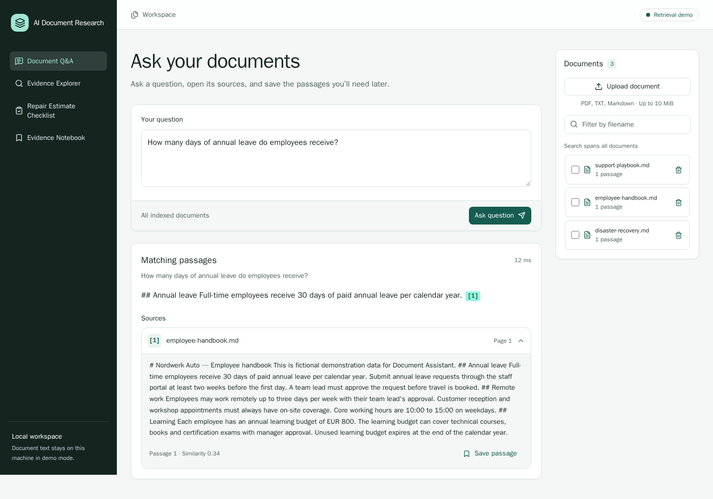
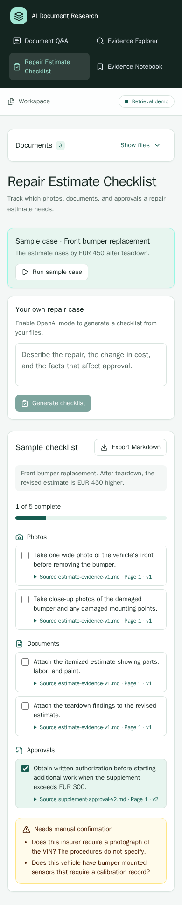
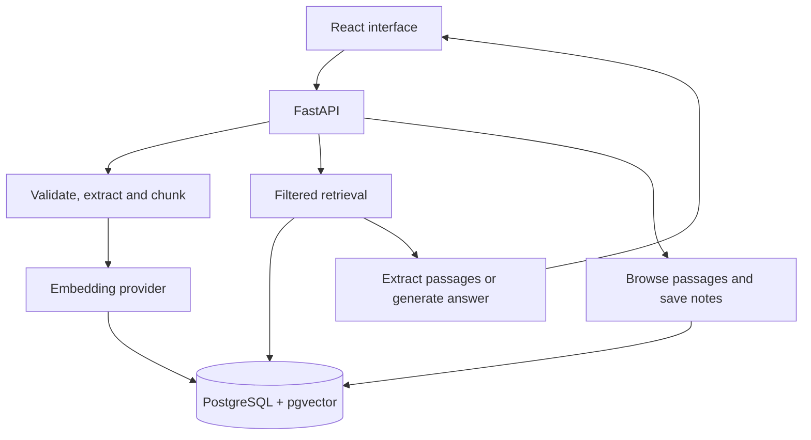

# AI Document Research

A full-stack **retrieval-augmented generation (RAG)** workspace for business documents. Upload a PDF, text file, or Markdown file, ask a question, and inspect the cited passage with its page reference. Save evidence with notes or turn workshop procedures into a repair estimate checklist.

**Python · FastAPI · OpenAI · PostgreSQL/pgvector · React · JavaScript · Tailwind CSS · Docker**

[](https://github.com/syeduzzaman/ai-document-research/actions/workflows/ci.yml)

[Run the demo](#quick-start) · [AI pipeline](#ai-pipeline) · [Mobile repair workflow](#repair-estimate-checklist) · [Tests](#tests-and-evaluation)



## Quick start

Prerequisite: Docker Desktop with Compose v2. On Windows, start Docker Desktop with Linux containers enabled.

Clone and start the app with Docker Compose.

```sh
git clone https://github.com/syeduzzaman/ai-document-research.git
cd ai-document-research
docker compose up --build --detach --wait
```

Open **http://localhost:8080**. The API documentation is at **http://localhost:8000/docs**.

No API key or model download is needed for the default demo. Three fictional Nordwerk Auto documents are indexed automatically: an employee handbook, a support playbook and a disaster recovery plan.

Try:

- How many days of annual leave do employees receive?
- What is the first response target for a P1 incident?
- When do database backups run?
- Which astronauts visited Jupiter? (The assistant should decline.)

To stop the app, run `docker compose down`. Your indexed documents remain in the database volume. **`docker compose down --volumes` deletes that local data.**

## What it demonstrates

- **Document Q&A** retrieves passages and opens the cited source directly from the answer.
- **Evidence Explorer** searches selected files or browses a single document in indexed page order.
- **Evidence Notebook** saves relevant passages and notes to PostgreSQL and exports them as Markdown.
- **Repair Estimate Checklist** groups required actions by category, tracks completion, and exports an evidence-linked checklist.
- PDF, TXT and Markdown uploads with bounded size, format validation and duplicate detection.
- Page-aware chunking with overlap and a persistent pgvector store.
- Retrieval restricted to selected documents, with embedding model isolation.
- Source citations with file name, PDF page, chunk identifier, exact extracted passage and similarity.
- Explicit insufficient-evidence responses.
- An optional OpenAI embedding and answer-generation pipeline.
- Unit, database integration, evaluation and browser tests in GitHub Actions.

Start with the annual leave question, open its citation, and save that passage. Switch to **Evidence Notebook**, add a note, and export the result. The notebook persists in the database across reloads. Deleting a document also deletes its saved notebook entries.

## AI pipeline

1. **Index documents.** FastAPI extracts text and preserves PDF page boundaries. It splits pages into overlapping chunks and stores them with embeddings in PostgreSQL/pgvector. [Ingestion](backend/app/service.py)
2. **Retrieve evidence.** The API ranks chunks by cosine similarity, scoped to the selected documents and the active embedding model. [Retrieval](backend/app/repository.py)
3. **Generate and check citations.** OpenAI mode sends the question and excerpts to the Responses API using a structured output schema. The backend checks each citation ID against the retrieved passages before returning the answer. [Answer generation](backend/app/answers.py)
4. **Review and save.** React opens the source from each citation and lets users save passages with notes. The repair workflow also checks that each quoted excerpt appears in its cited source. [Repair checklist](backend/app/repair.py)

### Demo and OpenAI modes

| Behavior | Demo (default) | OpenAI (opt-in) |
| --- | --- | --- |
| Embeddings | Deterministic 384-dimensional hashed word vectors | OpenAI embeddings, requested at 384 dimensions |
| Retrieval | PostgreSQL cosine similarity plus a lexical overlap check | PostgreSQL cosine similarity |
| Answers | Extracted matching sentences | Generated answers using retrieved evidence |
| External API calls | None | Document text and questions go to OpenAI |
| API key | Not required | Your OpenAI API key |
| Strength | Easy to run; deterministic baseline | Semantic retrieval and natural language synthesis |
| Limitation | Literal word matching; limited paraphrase support | API cost, provider availability and potential answer errors |

The local demo uses a deterministic lexical baseline with extracted sentences. OpenAI mode adds semantic embeddings and generated answers.

Similarity is a retrieval score, not a probability that an answer is correct.

## Enable OpenAI

Copy `.env.example` to `.env` (PowerShell: `Copy-Item .env.example .env`) and edit:

```dotenv
RAG_MODE=openai
OPENAI_API_KEY=your-own-key
OPENAI_EMBEDDING_MODEL=text-embedding-3-small
OPENAI_CHAT_MODEL=gpt-4.1-mini
```

Then run:

```sh
docker compose up --detach --force-recreate api web
```

The key stays on the backend. Never commit it. An API key with access to the configured models is required; model availability depends on your account.

Modes have separate embedding namespaces. The sample documents are indexed for the active mode on startup. Re-upload your own documents after changing mode or embedding model. Documents from other modes stay stored but do not appear in the active workspace or retrieval results.

In OpenAI mode, uploading sends extracted document text for embedding. Asking sends the question for embedding, and the question plus retrieved passages for answer generation. Answer requests set `store=False`; see OpenAI's current data policies for other retention details.

## Repair Estimate Checklist

Open **Repair Estimate Checklist → Run sample case** to see a fictional front bumper replacement
with an estimate that increases by EUR 450 after teardown. The bundled sample runs without an API key.
It uses the current revisions listed in [the sample manifest](sample-documents/repair/procedures.json).
The current approval procedure requires written authorization above EUR 300; the archived version used
a EUR 500 threshold. The checklist cites the current revision and flags missing information for manual review.

For a custom case, enable OpenAI mode, upload your current procedures, select them in the document library,
and describe the repair and known facts. The checklist searches the selected files, groups supported
actions under photos, documents, and approvals, and checks that each quote appears in its cited passage.
Review the sources and any open questions before using the result. The sample manifest governs the
bundled procedures. Select the applicable revisions yourself for uploaded files. Checklist progress is
held in the current browser session while the page stays open. Export Markdown to keep a copy of the
completed actions, their citations, and any questions that still need an answer.

<details>
  <summary>View the mobile repair checklist</summary>

  <p></p>
</details>

## Architecture



Documents are split into 150-word chunks with 25-word overlap without crossing PDF page boundaries. Extracted text, page numbers and embeddings are persisted. Original uploaded binaries are not retained.

The database uses exact cosine search for this small corpus. There is deliberately no approximate vector index yet. Exact search provides a simple correctness baseline; an HNSW index and retrieval benchmark would be useful when the corpus grows.

See [architecture and tradeoffs](docs/architecture.md) for details.

## API

| Method | Endpoint | Purpose |
| --- | --- | --- |
| GET | /api/health | Database readiness, mode and upload capabilities |
| GET | /api/documents | Documents in the current embedding namespace |
| POST | /api/documents | Multipart upload using the field `file` |
| DELETE | /api/documents/{id} | Remove a document, its chunks, and their notebook entries |
| GET | /api/documents/{id}/passages | Browse indexed passages with `offset` and `limit` |
| POST | /api/ask | Ask with optional document IDs and a top-k limit |
| POST | /api/search | Rank matching passages without generating an answer |
| GET | /api/bookmarks | List saved passages and notes in the active embedding space |
| PUT | /api/bookmarks/{chunk_id} | Save a passage, preserving any existing note |
| PATCH | /api/bookmarks/{chunk_id} | Update the note on a saved passage |
| DELETE | /api/bookmarks/{chunk_id} | Remove the notebook entry |
| GET | /api/repair-checklist/sample | Run the bundled repair case with current sample procedures |
| POST | /api/repair-checklist | Generate a cited checklist for a scenario and selected procedure IDs |

```sh
curl http://localhost:8080/api/ask   -H "Content-Type: application/json"   -d '{"question":"When do database backups run?","top_k":3}'
```

The question endpoint returns `answer`, `sources`, `mode`, `refused` and `elapsed_ms`. Citations refer to exact extracted passages; PDF text extraction may normalize layout.

## Tests and evaluation

The CI workflow runs:

1. Ruff and Python tests, including a real PostgreSQL/pgvector service.
2. A locked frontend install and a Vite/Tailwind production build.
3. Docker Compose build and startup readiness checks.
4. A twelve-question benchmark against the running stack.
5. Playwright browser tests for citations, uploads, refusal, evidence search, notebook persistence and export, checklist tracking, and narrow layouts.

The evaluation fixture contains ten answerable questions and two out-of-domain questions. It measures document Recall@3, document MRR@3, expected answer-fragment rate and refusal accuracy. These are a small regression suite, **not a general claim about RAG quality or hallucination rates**.

Run against the default sample corpus in demo mode:

```sh
python evaluations/evaluate.py
```

It prints per-question outcomes and aggregate metrics as JSON and exits nonzero on failure. Use Python 3.12+.

For Python development:

```sh
python -m venv .venv
# Activate .venv using the command for your shell.
pip install -e "backend[dev]"
ruff check backend
pytest -q backend/tests
```

Without `TEST_DATABASE_URL`, database integration/evaluation tests are skipped. Set it to a **dedicated disposable PostgreSQL database with pgvector** to run them. Integration tests truncate that database's documents table. CI creates its own disposable database.

For frontend development:

```sh
cd frontend
npm ci
npm run dev
```

Vite proxies `/api` to localhost:8000. Start the API and database with `docker compose up --build --detach --wait db api`. Run `npm run build` to produce the frontend bundle. Browser tests use the Compose app on port 8080 by default. Run `npx playwright install chromium`, then `npm run test:e2e`. Set `PLAYWRIGHT_BASE_URL` to test a different local instance.

## Scope and next steps

This is a single-workspace portfolio application intended for local use. Compose binds published ports to localhost and uses development database credentials. Public hosting needs authentication, per-user data isolation, request limits, secrets management and TLS.

Current limits: 10 MiB per upload, 40 PDF pages, UTF-8 text, no OCR or DOCX, synchronous indexing, and no conversation memory. Malformed or unsupported files produce readable errors.

Generated citations are checked against retrieved source IDs. This prevents references to invented source IDs; it does not prove every generated claim is supported. Retrieved text is treated as untrusted evidence, but prompt injection defenses need adversarial evaluation before public deployment.

The frontend uses `package-lock.json` and `npm ci`. Python dependencies use bounded version ranges.

Useful extensions: hybrid lexical/semantic retrieval, reranking, a larger adversarial evaluation set, OCR, background ingestion and authenticated workspaces.
